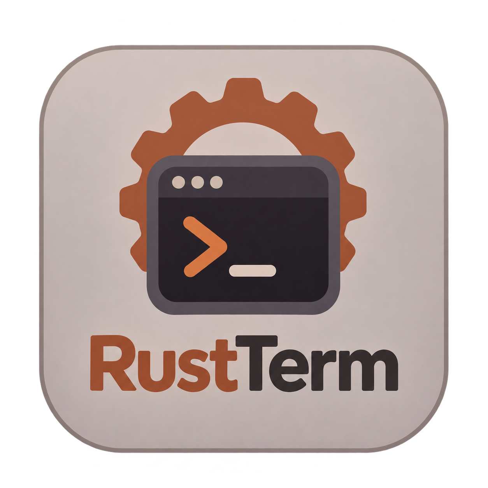

<p align="center">
  
</p>

<h1 align="center">RustTerm</h1>

<p align="center">
  Терминал последовательных портов для Windows — приём, отправка и анализ данных в одном приложении.
</p>

---

## Возможности

- **Работа с портами.** Основной и до 16 дополнительных COM-портов, независимые настройки, общий журнал и отправка на выбранный порт или всем подключённым.
- **Отправка.** Текст в UTF-8 или Windows-1251, HEX и десятичные байты, окончания строк, контрольные суммы, периодическая и файловая отправка.
- **Журнал.** Просмотр RX/TX в текстовом, HEX и десятичном виде, поиск, скрытие повторов, копирование, текстовая и двоичная запись, настраиваемая таблица декодирования.
- **Пакеты.** Разделение по символу, последовательности байтов, размеру или паузе приёма; парсеры HEX и текста с графиками и статистикой.
- **Автоматизация.** Списки команд, сценарии с задержками и отправкой файлов, эмулятор ответов, генератор пакетов и планировщик.
- **Инструменты.** Таблица ASCII, просмотр байтов файла и фоновое сравнение файлов.

## Быстрый старт

Нужны Windows, [Rust](https://www.rust-lang.org/tools/install) и инструменты сборки Microsoft C++ с поддержкой MSVC.

```powershell
git clone https://github.com/Paseditor/rust-term.git
cd rust-term
cargo run --release
```

Для отдельной сборки выполните `cargo build --release`. Исполняемый файл появится в `target\release\rustterm.exe`.

1. Выберите COM-порт и задайте скорость и формат соединения.
2. Нажмите **Подключить**.
3. Выберите формат команды: текст, HEX или DEC, введите данные и нажмите **Отправить**.

Автоматическое подключение и переподключение включаются отдельно. Автоответ и планировщик после запуска приложения выключены.

## Сценарии и генератор

Файл команд содержит по одной команде на строку. Доступны директивы:

```text
PING
[delay:]100
[sendfile:]payload.bin
[sendcmdlist:]001
```

Задержка указывается в миллисекундах. Относительные пути файлов разрешаются относительно файла команд; при запуске списка непосредственно из приложения каталог можно выбрать в окне списков. Ссылки на файлы и вложенные списки проверяются до начала сценария. Для текстовых команд выбирайте подходящую кодировку; символы, отсутствующие в Windows-1251, вызывают ошибку до отправки.

В генераторе `??` обозначает любой байт, а выражение вида `[00-0F,20]` — выбранные значения. Доступны последовательный и случайный перебор, ограничение числа пакетов, интервал и диапазон длины. При переменной длине последовательность может повторяться.

## Данные и настройки

Настройки хранятся локально в `%APPDATA%\RustTerm\settings.json`. Именованные наборы позволяют сохранять настройки портов, команд и инструментов. Перед применением набора отключите порты: текущие настройки будут заменены, а автоматическая отправка остановлена.

Текстовый и двоичный журналы дописываются к выбранным файлам. Текстовый журнал содержит время, порт, направление и HEX-байты; двоичный — объединённый поток RX и TX без метаданных. Фильтры, пауза и скрытие повторов влияют на экран, но не на запись. В памяти отображаются последние 10 000 строк.

При включённом преобразовании битов RX записывается в журналы до преобразования, TX — после него. Порция чтения не обязательно совпадает с пакетом: при необходимости выберите способ разделения в настройках журнала. `RX*` обозначает неполную часть пакета.

## Проверка проекта

```powershell
cargo fmt --check
cargo test
cargo clippy -- -D warnings
```

Тесты с физическим портом не запускаются автоматически. Подключите RX к TX и явно укажите порт, чтобы проверить устройство:

```powershell
$env:RUSTTERM_TEST_PORT = 'COM5'
cargo test hardware_loopback -- --ignored
```

Точность задержек, доступные режимы порта и управление потоком зависят от адаптера, драйвера и подключённого оборудования.

---
